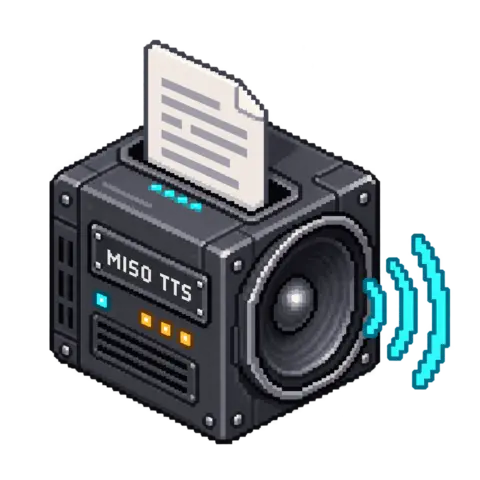

# Miso TTS

[](media/cover.png)

<!-- block-metadata:start -->
[](model.json)
[](compatibility.json)
[](LICENSE)

Verified BloxSmith versions: **1.0.9** (bundled-block tests; see [test evidence](compatibility.json)).
<!-- block-metadata:end -->

Development package, not a published release. The local model adapter, block
runtime and English/French settings are implemented. Real-model qualification
is **pending**: the test host lacks the asset space, available RAM and authorized
tokenizer required for an actual Miso run. Synthetic protocol tests must not be
read as evidence of speech quality, watermark detectability or CPU/GPU performance.

Local English speech generation uses **Miso TTS 8B**, with a text
input, an explicit interrupt command, a completed audio-file output and metadata.
A file path is not a streaming audio port. The official engine and its separate
weights are used directly; no coding-agent substitute or hosted API fallback.

## Connect it

| Port | Contract |
| --- | --- |
| `text` input | Plain English text, or an `application/json` object with exactly `text` and `request_id`. Plain text resembling JSON remains speech. |
| `command` input | JSON `{"action":"interrupt"}`. Other actions are refused without replaying earlier text. |
| `audio_file` output | Absolute path to a complete, uniquely named WAV or Ogg/Opus file. |
| `metadata` output | Request ID, path, size, SHA-256, duration, sample rates, applied settings and pinned model/engine revisions. |
| `status` output | Correlated `completed`, `queue_full`, `interrupt_requested`, `interrupted`, or a safe recoverable failure code. |

Example correlated text request:

```json
{"text":"Your report is ready.","request_id":"report-17"}
```

Request IDs contain 1–128 letters, digits, underscores, periods, colons or hyphens.
They provide correlation, not deduplication: sending the same request again creates
a new job. There is no automatic retry, voice-reference upload or cloud fallback.

In **Active Runtime**, the public listener starts with Run but remains passive
until text arrives. It runs one inference process at a time and retains at most
the configured number of pending requests (four by default). A full queue rejects
new text on `status`; it does not intentionally fail the Run. An interrupt cancels
the current job, clears earlier pending requests and suppresses its late result.
New text sent after the interrupt can start a new job. This bound applies to the
block's own queue, not a guarantee about upstream event retention in the framework.

In **One Shot**, a text activation runs synchronous local synthesis. An interrupt
when idle reports `idle`; it does not interrupt another concurrently executing
One Shot activation. Run Stop cancels the owned process in both runtimes. Preparation
does not load weights. Reload a prepared Run after changing listener settings.

## Completed files and interruption

The model is loaded for each accepted request and released afterwards. The worker
requires a genuine end-of-sequence audio frame, validates the mono waveform and
keeps the model's watermark step. Reaching the duration budget without EOS fails
with `audio_limit`; truncated speech is not published as a completed result.

WAV is mono 24 kHz PCM16. Ogg/Opus is encoded at 48 kHz using FFmpeg. Peaks are
attenuated when necessary to avoid PCM clipping; metadata reports the applied
gain and original 24 kHz frame count. `watermarked: true` means the official
watermark step ran, not a certified detection result after resampling or encoding.

Incomplete files stay inside a private job directory. A successful file is copied
to a private temporary destination and atomically linked under a unique name;
existing files are never overwritten. Empty output-directory settings use
`get_block_storage_dir()/audio/`. Relative configured paths use the application root.
Completed files persist until their owner removes them; no automatic cleanup is run.

The listener checks queued interrupts before publishing a finished job. A file
already committed just before Stop or a new interrupt may remain, and already
delivered files cannot be recalled. This is not a transaction with downstream
blocks and does not stop a separate player. Native work is supervised in an owned
process group, including parent-death cleanup; this is process isolation, not an
OS security sandbox.

Normal completion, failure and cooperative interruption remove private job
directories. A forcibly terminated package host can prevent Python's finalizer
from running: an unreferenced `miso-job-*` directory may remain in node storage.
Its native process is killed and it has no completed-file output. Inspect and
remove such residual directories only after the Run has stopped; do not treat
their contents as a successful synthesis. No crash-recovery cleanup or exactly-once
publication guarantee is claimed.

## Model preparation

`model_artifacts.json` pins the engine, Miso weights, Mimi codec, SilentCipher
watermarker and Llama tokenizer to immutable revisions. LFS weight files use
SHA-256; small source/tokenizer files use their upstream Git blob object hash.
The helper checks exact sizes and content, refuses corrupted existing files and
never replaces them silently.

Read-only inventory, with no downloads or directory creation:

```sh
python setup_model.py --directory MODEL_ASSET_DIRECTORY
```

The tokenizer comes from `meta-llama/Llama-3.2-1B`, an access-controlled repository.
Obtain its official authorization yourself and prepare the five listed files in
`MODEL_ASSET_DIRECTORY/tokenizer/` at the exact revision in the manifest. Do not
substitute a mirror to bypass that authorization. The helper never reads Hugging
Face credentials, accepts licenses or attempts to fetch gated files.

Once those files are legally prepared, this explicit command downloads only the
remaining public assets from their pinned official locations:

```sh
python setup_model.py --directory MODEL_ASSET_DIRECTORY --download-public
```

Approximately **33.2 GB** of declared assets are required, plus at least 1 GiB
download headroom, the Python environment and inference working space. No weights,
tokens, virtual environments or generated audio belong in Git. The current host
does not have sufficient free disk for a real-model qualification.

The upstream environment targets Python 3.10–3.12, PyTorch/torchaudio 2.4.0,
Moshi 0.2.2 and additional pinned packages listed in the official engine's
`requirements.txt`. It must be installed separately, never into the framework
automatically. Plan for the upstream RAM/VRAM requirements, including model-loading
peaks. The advertised hosted-API latency is not a benchmark of this local adapter.

Use this package's `requirements.txt` in that separate environment and configure
its Python executable. The executable is trusted administrator configuration, not
a graph input. The worker verifies the declared core dependency versions and the
SilentCipher fork's installation provenance. No installation occurs at Run.

Before execution, store a private JSON array of **five integers from 0 to 255**
in the BloxSmith wallet. Configure only its reference, for example
`secret://workspace/miso_watermark`. The resolved key is sent through the worker's
private stdin pipe, never argv, graph metadata or logs. A locked or missing wallet
fails recoverably. Do not reuse the upstream demonstration key in a deployment.

The default RAM preflight is **64 GiB available**, with a 96 GiB virtual-address
limit. The original engine builds a float32 model before conversion, so bfloat16
steady-state size is not the loading peak. These are adjustable refusal thresholds,
not memory reservations or a guarantee of successful allocation. CPU and CUDA are
explicit choices; unavailable CUDA does not silently fall back. Real-device
performance and VRAM requirements remain to be measured on the qualification host.

## Provenance and terms

The block-owned adapter is Apache-2.0. Dependencies and downloaded model assets
retain their own terms; the Apache license does not replace them.

- [Miso source](https://github.com/MisoLabsAI/MisoTTS/tree/cd7dde13dbfec33fd8321e6c34a43f86724a8bad)
  and [weights](https://huggingface.co/MisoLabs/MisoTTS): Modified MIT license,
  including an additional UI attribution condition at the stated commercial scale.
- [Mimi weights by Kyutai](https://huggingface.co/kyutai/moshiko-pytorch-bf16):
  CC BY 4.0 as declared in the model card. Only the Mimi codec is used, not the
  separate Moshi language model.
- [SilentCipher model](https://huggingface.co/Sony/SilentCipher) and the
  [MIT-licensed Sesame loader fork](https://github.com/SesameAILabs/silentcipher/tree/d46d7d0893a583d8968ab3a6626e2289faec9152).
  The Miso-required watermark must remain active; use a private deployment key.
- [Llama tokenizer](https://huggingface.co/meta-llama/Llama-3.2-1B): Llama 3.2
  Community License and Acceptable Use Policy, not Apache-2.0; preserve the
  supplied license and policy and meet the upstream access conditions.

No upstream engine, weights or private framework are redistributed here.

## Tests and qualification scope

`python -B tests/test_assets.py` runs eight portable offline checks of the asset
manifest, read-only inventory/qualification helper, access/disk gates, exact hashes, symlink/FIFO
refusal, download integrity and redirect policy. Synthetic four-byte files test
the downloader; they are not substitutes for Miso weights and are never used to
claim synthesis quality or framework compatibility.

The package also owns three framework-harness suites: native-adapter and file
contracts, both runtimes across bundled/managed/linked installations, and responsive
English/French modal/inspector behavior. They use an explicitly synthetic model
process, real process supervision, real FFmpeg encoding/decoding, disposable wallet
secrets and temporary projects. They cover EOS refusal, Stop/parent death, bounded
queues, interruption/recovery, reordered ports, secret redaction and Apply/Cancel.
No proprietary framework or actual Miso assets are bundled in this repository.

Full model qualification remains a separate required gate: prepare authorized
pinned assets and the dedicated environment on a sufficiently provisioned host,
then exercise actual speech generation, duration refusal, interruption and retained
file playback in the real block. Do not infer that gate from fixture results.

An optional smoke helper defaults to read-only inventory. Add `--execute` only on
the prepared host; it asks for the private watermark JSON without echo and writes
a unique audio file under the explicit results directory:

```sh
python -B tests/qualify_model.py --directory MODEL_ASSET_DIRECTORY \
  --python MISO_ENVIRONMENT_PYTHON --device cuda:0 \
  --results-directory QUALIFICATION_RESULTS --execute
```

Use `--key-stdin` only with a secure stdin source; never put the key in shell
arguments or a tracked script. A successful smoke test verifies actual inference
and file structure, not pronunciation, latency or watermark detection. The emitted
JSON report contains no key. Listening and actual-runtime Stop testing remain required.
